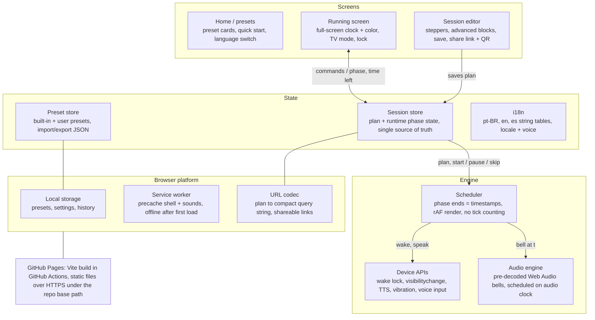
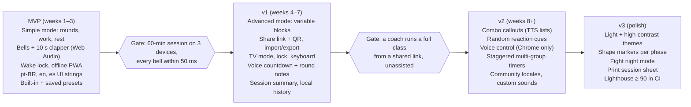

# Fight Timer — Research & Blueprint

As of 2026-10-31. Source of truth for scope and architecture; the living copy is a Claude doc, this file is the version the code follows.

## Summary

Build a free, installable, offline-capable round timer for fight coaches, hosted on GitHub Pages, that does the one job every competitor gets wrong on the web: the bell rings exactly on time, loud, with the screen awake, and the display reads from across the gym.

The market is crowded with native apps (30+ on iOS alone) but nearly all are subscription-gated, English-only, and the web alternatives are generic HIIT timers that drift, go silent in background tabs, and lack fight-specific features (10-second clapper, warm-up, sport presets, round-by-round scripts). The web gap is real: no download, works on the coach's phone, a tablet on the wall, or a laptop plugged into a gym TV, and one URL shares a whole session plan.

Target users, in order: (1) coaches running group classes or sparring sessions on a wall-mounted phone/tablet/TV; (2) fighters training solo on bag or pads; (3) HIIT/conditioning use as a bonus. Multilanguage is a core requirement from day one (pt-BR, en, es at launch; architecture for more).

Non-goals for v1: accounts, cloud sync, social features, video lessons, native app stores.

## Market research

Every serious competitor converges on the same core (rounds × work/rest, warm-up, warning before bell, saved presets, big color-coded display), and differentiates on reliability (bell with screen locked), sounds, and coaching extras. Pricing is overwhelmingly subscription or one-time Pro unlock; the reference app, Boxing Timer Pro, drew user backlash when it moved paid features to a subscription.

| App | Platform | Notable features | Pricing | Weak spots / user complaints |
| --- | --- | --- | --- | --- |
| [Boxing Timer Pro Round Timer](https://apps.apple.com/us/app/boxing-timer-pro-round-timer/id423335220) (SimpleTouch) | iOS, 4.9★ / 6.6K | Works screen on/off, portrait+landscape, volume + vibration, pause/resume, AirPlay to external display, "Workout DJ" auto music, programmable presets, 9 bells | Free + Pro subscription (~US$13–25/yr) | Subscription switch angered legacy buyers; English only |
| [Seconds Pro](https://apps.apple.com/us/app/seconds-pro-interval-timer-for-hiit-tabata/id363978811) (Runloop) | iOS/Android, 4.8★ / 11.6K | Templates (HIIT, Tabata, circuit), fully custom interval lists, compound timers, text-to-speech interval names, large color-coded full-screen display, share timers, Apple Watch | US$7.99 one-time | Feature-heavy and confusing for a simple round; Android version lags |
| [Boxing Timer Round](https://apps.apple.com/ci/app/boxing-timer-round/id6766887284) | iOS | Sport presets (Boxing 12×3/1, MMA 3×5/1, Muay Thai 5×5/2, HIIT 8×0:30/0:30), background-accurate timer + local notifications, 5 bells, haptic pulse at 10 s, color-coded phases | 3 free workouts/day; Pro US$9.99/yr or US$24.99 lifetime | Daily cap on free tier |
| [Boxing Timer – Punch Clock](https://mwm.ai/apps/boxing-timer-punch-clock/6788214618) | iOS | Coach Mode (random combo callouts, 3 levels), hands-free voice control ("pause", "go", "skip"), repeating inner-round alerts (e.g. every 30 s), 10-second wood clack, warm-up | Free with ads | New, few ratings |
| [RoundBlitz](https://mwm.ai/apps/roundblitz-boxing-timer/6759731041) | iOS | Giant digits, landscape wall-clock mode, prep countdown, unlimited presets, total time + rounds remaining, Apple Watch gesture auto-pause | US$5.99 one-time | Landscape mode is paywalled |
| [Boxing Combo Timer](https://mwm.ai/apps/boxing-combo-timer/6755162811) | iOS | Custom combo callouts (TTS), reaction training, share routines with coaches, HIIT/Tabata modes, music keeps playing | Free | Solo-training focus, not coach display |
| [Random Tactical Timer](https://apps.apple.com/bb/app/random-tactical-timer/id6758355312) | iOS | Random cue inside min/max range, hidden-countdown mode, loop mode | Free + Pro | Niche; no standard round mode |
| [Boxing Round Timer](https://chrome-stats.com/d/id406841961) (Gamagori88) | iOS, 3.2★ | Simple, free | Ads | Ads every ~30 s that stop the timer; unreliable bells; dies in background |
| [Boxing Interval Timer](https://apps.apple.com/app/id1318795527) | iOS | Round timer + Tabata | US$4 ad removal | Timer stops when screen locks, even in paid version |
| [intervaltimer.com](https://intervaltimer.com/) | Web | HIIT/Tabata/EMOM/rounds presets, no sign-up | Free | Generic; no fight-specific protocol; no offline |
| [clock7 interval timer](https://www.clock7.com/interval-timer) | Web | Work/rest/sets, Web Audio beeps (no asset loading) | Free | Minimal, no presets persistence, no fight features |

What users praise, consistently: bell keeps ringing with screen locked or in another app; big numbers readable from distance; no ads; one-tap presets; music keeps playing.

What users punish, consistently: ads that interrupt the timer; timer that pauses when the screen locks; bells that fail or get buried under music; accidental taps mid-round; subscriptions for features that used to be one-time.

## Core feature set (table stakes)

These are the features every credible competitor ships; missing any one of them makes the app unusable for a coach.

**Session structure**

- Number of rounds (1–99, or ∞ for open-ended sessions)
- Round (work) length, rest length, independently set in mm:ss with 1-second precision
- Prep / get-ready countdown before round 1 (0–60 s, default 10 s)
- Optional warm-up and cool-down blocks
- Total session duration shown live on the setup screen as values change

**Alerts**

- Start bell, end bell (classic boxing bell by default)
- End-of-round warning: the 10-second "clapper" / wood clack, configurable 5–60 s before the bell
- End-of-rest warning ("seconds out") so fighters get back to position
- Repeating inner-round alert (e.g. every 30 s or 60 s) to signal pace changes or partner switches
- 3-2-1 voice or beep countdown into each round
- Sound library: boxing bell, triple bell, gong, air horn, buzzer, whistle, wood clack, chime, drum, beep; per-event sound selection (round start, round end, warning, countdown, end of session) in the editor
- Volume control inside the app, independent of music; vibration/haptics where the browser allows

**Presets**

- Built-in sport presets with real competition rules: Boxing pro 12×3:00/1:00, Boxing amateur 3×3:00/1:00, MMA 3×5:00/1:00 and 5×5:00/1:00, Muay Thai 5×3:00/2:00, Kickboxing 3×3:00/1:00, BJJ 5:00–6:00 rolls, Wrestling 3×2:00, Tabata 8×0:20/0:10, EMOM
- Save, rename, duplicate, reorder and delete user presets; quick-start from the home screen

**Display**

- Full-screen countdown numerals, phase label (Get ready / Round / Rest), "Round X of Y"
- Whole-screen color state: amber prep, green work, red rest
- Portrait and landscape; landscape doubles as wall-mounted gym clock
- Dark background by default; screen stays awake while running
- Progress indicator for the whole session (rounds done / remaining)

**Controls**

- Start, pause/resume, skip to next phase, restart round, stop session
- Large tap targets usable with wraps or gloves; tap-anywhere to pause/resume; lock-screen toggle to block accidental taps mid-round
- Keyboard shortcuts (space = start/pause, → = skip) for laptop + TV setups

**Reliability**

- Timing anchored to wall-clock timestamps, never tick counting (no drift over a 60-minute session)
- Bells fire on time even when the tab is throttled or the screen is off
- Fully offline after first load; zero network calls during a session
- No ads, no account, no paywall

## Additional and differentiating features

The gap in the market is the coach running a class, not the solo fighter: nobody serves the wall-mounted display, the multilingual gym, or the shareable session plan well. The features below are ranked by value to that coach versus implementation cost.

| Feature | Why it matters | Who has it today | Effort |
| --- | --- | --- | --- |
| Multilanguage UI + voice (pt-BR, en, es first; community-extendable) | Gyms in Brazil, LatAm, Europe run mixed classes; almost every competitor is English-only | Boxing Timer: For Training (partial) | Low (i18n from day one) |
| Shareable session URL (whole plan encoded in the link / QR code) | Coach builds the plan at home, opens it on the gym tablet; students can replay the same session | Seconds Pro (app-to-app only) | Low |
| Session script: per-round labels and notes ("Rd 3 – body shots only", "Rd 5 – southpaw") read aloud and shown big | Turns the timer into a class plan; coach stops shouting instructions | Seconds Pro (TTS interval names), Knockout | Medium |
| Variable rounds inside one session (e.g. 3×3:00 technique, 2×2:00 sparring, 4×0:30 burnout) | Real classes are not uniform; competitors force one work/rest pair | Seconds Pro, SmartWOD Pro mode | Medium |
| Big-screen / TV mode: landscape, no chrome, numerals filling the viewport, high-contrast palette, optional mirrored second window | Coaches already plug phones into TVs (AirPlay feature in Boxing Timer Pro); web makes this trivial via HDMI/Chromecast tab | Boxing Timer Pro (AirPlay), RoundBlitz (Pro only) | Low |
| Random reaction cues (cue at random time within min/max, optional hidden countdown) | Reaction training for pads and sparring; proven demand | Random Tactical Timer, Boxing Round Timer Pro, Knockout | Low |
| Combo callouts (TTS from a user-editable combo list, numbered or named punches, difficulty tiers) | Solo bag work without a coach; TTS is free in the browser | Punch Clock, Boxing Combo Timer, BoxingTimer.io | Medium |
| Hands-free control: voice ("pause", "go", "skip") and clap/noise detection | Gloves on, phone across the room | Punch Clock (voice) | Medium (Web Speech API; mic permission) |
| Multi-group staggered timers (two or three groups offset by N seconds, e.g. pads vs bag station rotation) | Circuit classes rotate stations; nobody does this | None | Medium |
| Sound mixing: choose bell per event; preview sounds; custom sound upload | Top complaint category | Partial everywhere | Low–Medium |
| Session end summary (rounds, total work, total rest) and lightweight local history | Coaches want to log the class without an account | Boxing Timer: For Training, Knockout | Low |
| Install as app (PWA), works offline, zero ads forever | Removes the two biggest complaints at once | Native apps only | Low |
| Accessibility: screen-reader labels, high-contrast theme, color-blind safe phase palette (shape + label, not color alone), reduced-motion | Rare in this category; cheap on the web | None visibly | Low |
| Import/export presets as JSON; print-friendly session sheet | Coach backup, sharing between devices without accounts | None | Low |
| Optional "fight night" mode: hides setup, shows only clock + round, adds 10-second clapper exactly like amateur rules | For in-gym smokers and interclub events | None | Low |

Deliberately excluded: accounts and cloud sync (adds a backend and breaks the GitHub Pages constraint), video lessons, calorie tracking, heart-rate integration (Web Bluetooth is Chrome-only and off-mission).

## UI / UX blueprint

Design principle: the display is the number. Everything else gets out of the way once the session starts, and the bells are the real interface. Three screens only.

**1. Home / presets**

- Grid of preset cards (sport icon, name, "12 × 3:00 / 1:00 · 47 min"), one tap = start, long-press = edit. Built-in presets first, user presets after, drag to reorder.
- Persistent bottom bar: Quick start (last used), New session, Settings.
- Language switcher visible in Settings and on first launch (auto-detect from browser, remember choice).

**2. Session editor**

- Simple mode (default): three large steppers — Rounds, Round time, Rest time — plus Prep toggle. Steppers use ±15 s / ±1 round increments with a tap-and-hold accelerator; tapping the value opens a numeric wheel for 1-second precision.
- Advanced mode (expandable): warm-up, cool-down, warning offset, inner-round alert interval, per-event sounds, variable rounds list (add / duplicate / reorder round blocks, each with its own work/rest/label/note), random cue settings, voice callouts.
- Live header: total duration and a proportional bar of work (green) / rest (red) / prep (amber).
- Actions: Start, Save as preset, Share link (copies URL + shows QR).

**3. Running screen**

- Whole viewport takes the phase color; numerals in a tabular-figure font sized to fill ~60% of the shorter viewport side (mm:ss, tenths only under 10 s if enabled).
- Top row: phase label ("ROUND 3 / 12", "REST", "GET READY") and the round label/note when present. Bottom row: elapsed total, next phase preview ("Next: Rest 1:00").
- Thin session progress strip along one edge: one segment per round, filled as completed.
- Controls: single large center tap = pause/resume; swipe or small side buttons for Skip and Restart round; Stop requires a 1-second hold or confirm. A lock toggle disables everything except unlock (hold 2 s). Controls auto-hide after 3 s of inactivity in TV mode.
- Last 10 seconds of a round: numerals pulse once per second, optional flash on the warning cue; color changes are accompanied by a label change and a sound, so no information depends on color alone.
- End screen: rounds completed, work/rest/total, buttons for Repeat, Edit, Home.

**Visual system**

- Dark theme by default (gym lighting, OLED wall phones); optional light theme.
- Phase palette: Prep amber #F5A623, Work green #2ECC71, Rest red #E74C3C, Paused desaturated slate #3B4252 with the previous color as a thin border. High-contrast variant swaps to pure white digits on near-black with colored frame only.
- Typography: one geometric sans for UI, one condensed tabular numeral face for the clock (so digits don't jitter as they change). Minimum text size 16 px; clock never below 96 px on phones, scales with `vmin` on larger screens.
- Motion: minimal. Color crossfade 150 ms on phase change, no animations during countdown except the final-10-second pulse. Honor `prefers-reduced-motion`.
- Layout: mobile-first portrait; at landscape or ≥ 1024 px the setup moves to a side panel and the clock takes the rest; in TV mode everything but clock, phase and round counter disappears.

**Interaction rules**

- Nothing destructive within one tap during a running session.
- Every alert has a visible counterpart (label change, flash) and every visual change has an audible one.
- First run: a one-time "Tap to enable sound" gate (browser autoplay rule) and a sound-check button that plays each bell.
- Settings are flat, searchable by eye, and grouped: Sounds, Display, Language & Voice, Data (export/import/reset).

## Technical architecture (GitHub Pages)

A static single-page PWA, no backend: Vite + TypeScript, a small UI library (Preact or Svelte; vanilla is viable but costs more in state handling), `vite-plugin-pwa` for the service worker and manifest, hash-based routing because GitHub Pages has no SPA fallback, and a GitHub Actions workflow that builds and deploys `dist/` on every push to `main`.



Screens render from the session store; the scheduler owns time and tells the audio engine when the bell lands, so a slow render never delays a bell.

**Accurate timing (the hard part)**

- Never count ticks. When a phase starts, store `phaseEndsAt = performance.now() + duration` (plus a `Date.now()` mirror for recovery) and derive remaining time on every frame with `requestAnimationFrame`. A naive `setInterval` decrement drifts by seconds over a 20-minute session.
- Schedule each bell on the Web Audio clock: `source.start(audioCtx.currentTime + delta)`. The audio thread is not subject to background-tab throttling; measured drift on a backgrounded 5-minute timer is 4–13 s with `setTimeout` versus under 10 ms with Web Audio scheduling.
- Use a look-ahead scheduler (poll every ~250 ms, queue any cue falling in the next 1–2 s) so timer jitter never reaches the bell. A Web Worker heartbeat is a second line of defence for the UI tick when the tab is hidden.
- On `visibilitychange` back to visible, recompute phase and remaining time from the stored timestamps and re-sync the display; if a boundary was missed while hidden (iOS suspended the page), fire the missed cue immediately and continue.

**Audio**

- One `AudioContext`, created and resumed on the first user gesture (the "Tap to enable sound" gate); pre-decode every bell to an `AudioBuffer` at load, never fetch at bell time.
- Ship a small set of CC0/own-recorded samples (bell, clack, horn, whistle, beep) plus a synthesized fallback beep via `OscillatorNode` so sound works even if assets fail.
- Master gain node for in-app volume; ducking of the user's music is not possible from a web page — document this honestly; bells play alongside music.
- Voice: `speechSynthesis` for countdown, round labels and combo callouts, voice chosen from the locale; Web Speech recognition for "pause / go / skip" is Chrome/Edge-only and optional.

**Keeping the screen on**

- `navigator.wakeLock.request('screen')` on start, re-request on `visibilitychange`, release on stop. Baseline since March 2025: Chrome/Edge 84+, Firefox 126+, Safari 16.4+, iOS Safari 18.4+. HTTPS required (GitHub Pages provides it).
- Fallback for browsers without it (older iOS, iOS installed-PWA quirks): a hidden looping muted video (the NoSleep technique) or simply a visible banner telling the coach to disable auto-lock.

**Storage and sharing**

- `localStorage` for settings and presets (a few KB); `IndexedDB` only if session history or custom uploaded sounds are added.
- Share link: plan serialized to a compact scheme (`#/s?r=12&w=180&rest=60&prep=10&warn=10&n=Sparring`) with base64url JSON for variable-round scripts; a QR code rendered client-side. Opening the link lands on the editor pre-filled, one tap from Start.
- Import/export of all presets as a JSON file.

**Internationalization**

- String tables per locale in `/src/locales/{pt-BR,en,es}.json`, loaded with the bundle (they are tiny); `Intl.NumberFormat`/`Intl.DateTimeFormat` for numbers and dates; `lang` attribute set on `<html>` for TTS and screen readers.
- Auto-detect from `navigator.languages`, override in Settings, persist. Pluralization handled by `Intl.PluralRules`. Every string, including voice callouts and sound names, goes through the table; no concatenated sentences.
- Contribution path: a new locale is one JSON file plus a voice mapping; validate completeness in CI with a key-diff script.

**Offline and install**

- Service worker precaches the app shell, fonts and all sounds on first visit (total target under 1 MB); `autoUpdate` strategy with a non-blocking "New version available" toast that never interrupts a running session.
- Web app manifest: `display: standalone`, portrait-any orientation, dark theme color, maskable icons; `start_url` and `scope` must include the repo base path.

**Testing and quality**

- Scheduler unit-tested against a fake clock (phase transitions, pause/resume math, skip, missed-boundary recovery).
- Playwright smoke tests for the three screens and the share-link round trip; Lighthouse PWA audit in CI.
- Manual device matrix before each release: Android Chrome (phone, tablet), iOS Safari and installed PWA, desktop Chrome/Firefox/Safari plugged into a TV.

## Data model

One `SessionPlan` describes everything the timer will do; the runtime compiles it into a flat list of timed `Phase` segments with absolute end timestamps, so the scheduler never reasons about rounds, only about the next boundary.

```typescript
// Durations in seconds. Everything optional has a default in settings.
type Sound = 'bell' | 'gong' | 'horn' | 'whistle' | 'clack' | 'beep' | 'none';

interface Cue {
  at: number;              // seconds before the END of the phase (10 = classic clapper)
  sound: Sound;
  voice?: string;          // i18n key or literal text to speak
  repeatEvery?: number;    // inner-round alert, e.g. 30 => every 30 s from phase start
}

interface RoundBlock {
  id: string;
  label?: string;          // "Technique", "Sparring", "Burnout"
  note?: string;           // shown big + spoken at round start
  count: number;           // how many rounds in this block
  work: number;
  rest: number;
  cues?: Cue[];            // overrides plan-level cues
  random?: { minGap: number; maxGap: number; sound: Sound; hideClock?: boolean };
  callouts?: string[];     // combo list for TTS, picked at random or in order
}

interface SessionPlan {
  version: 1;
  id: string;
  name: string;
  sport?: 'boxing' | 'mma' | 'muaythai' | 'kickboxing' | 'bjj' | 'wrestling' | 'hiit' | 'custom';
  prep: number;            // get-ready countdown before round 1
  warmup?: number;
  cooldown?: number;
  blocks: RoundBlock[];    // simple mode = exactly one block
  cues: Cue[];             // defaults: [{at:10, sound:'clack'}]
  restCues?: Cue[];        // e.g. [{at:10, sound:'beep', voice:'seconds_out'}]
  sounds: { start: Sound; end: Sound; restEnd: Sound; countdown: Sound };
  builtIn?: boolean;
}

// Compiled at start; the only thing the scheduler reads.
interface Phase {
  kind: 'prep' | 'warmup' | 'work' | 'rest' | 'cooldown';
  index: number;           // round number for work/rest
  total: number;           // total rounds
  duration: number;
  label?: string;
  note?: string;
  cues: Array<{ offset: number; sound: Sound; voice?: string }>; // offsets from phase start
}

interface RuntimeState {
  status: 'idle' | 'running' | 'paused' | 'finished';
  phases: Phase[];
  current: number;         // index into phases
  phaseStartedAt: number;  // performance.now() ms
  phaseEndsAt: number;     // performance.now() ms; recomputed on resume
  pausedRemaining?: number;
  wallClockAnchor: number; // Date.now() at start, for recovery after suspend
}

interface Settings {
  locale: 'pt-BR' | 'en' | 'es' | string;
  voice: { enabled: boolean; name?: string; rate: number };
  volume: number;          // 0..1 master gain
  vibrate: boolean;
  keepAwake: boolean;
  theme: 'dark' | 'light' | 'high-contrast';
  tvMode: boolean;
  lockDuringRound: boolean;
  showTenths: boolean;
}
```

**Built-in presets (seed data)**

| Preset | Rounds | Work | Rest | Prep | Notes |
| --- | --- | --- | --- | --- | --- |
| Boxing pro | 12 | 3:00 | 1:00 | 10 s | 10-second clapper |
| Boxing amateur | 3 | 3:00 | 1:00 | 10 s | |
| MMA | 3 | 5:00 | 1:00 | 10 s | 5-round title variant |
| Muay Thai | 5 | 3:00 | 2:00 | 10 s | |
| Kickboxing | 3 | 3:00 | 1:00 | 10 s | |
| BJJ rolls | 6 | 5:00 | 1:00 | 5 s | |
| Wrestling | 3 | 2:00 | 0:30 | 5 s | |
| Tabata | 8 | 0:20 | 0:10 | 10 s | |
| EMOM | 10 | 1:00 | 0:00 | 5 s | beep each minute |
| Pad class (variable) | 3+3+2 | 3:00 / 2:00 / 0:30 | 1:00 / 0:45 / 0:15 | 10 s | demo of multi-block |

**Storage keys**: `ft.settings`, `ft.presets` (array of `SessionPlan`), `ft.history` (optional, last 50 sessions), `ft.schemaVersion` with a migration function per version bump. Share links carry `SessionPlan` minus `id`/`builtIn`, compressed with a short-key map.

## Roadmap

Three phases, each gated by a real-world test rather than a feature count. Week estimates are indicative for one developer working evenings; the gates are the commitment.



Nothing from v1 starts until the MVP gate passes on an Android phone, an iPhone and a laptop plugged into a TV.

**MVP acceptance criteria**

- [ ] Simple-mode session (rounds, work, rest, prep) runs 60 minutes with every bell within 50 ms of its scheduled time, measured by recording the audio output next to a reference clock
- [ ] Bells fire with the screen off or the tab in background on Android Chrome and desktop browsers; on iOS Safari the display re-syncs correctly on return and any missed bell fires immediately
- [ ] Screen stays awake for the whole session on devices that support Wake Lock; banner shown where it is not supported
- [x] App installs as a PWA and runs a full session in airplane mode after one prior visit — `tests/e2e/pages.spec.ts` registers the service worker under the base scope, goes offline and reloads
- [x] Complete pt-BR, en and es string tables; switching language needs no reload and no string is hard-coded — `src/i18n/i18n.test.ts` diffs every table against `en.json`; the journey switches locales live
- [ ] Phase colors are legible from 5 m in gym lighting; digits never jitter (tabular numerals)
- [x] No destructive action is one tap away while running; lock toggle works with gloves — Stop needs a 1 s hold then a confirm, unlock a 2 s hold (`tests/e2e/journey.spec.ts`)
- [x] Lighthouse PWA and accessibility scores at or above 90 — `npm run audit` (in CI) fails below 90 on accessibility, best practices and performance for the home, editor and settings routes; measured 96–100. Lighthouse 12+ dropped the PWA category, so installability is proven by the manifest and service-worker tests instead

**v1 acceptance criteria**

- [x] A plan with three different round blocks round-trips through a share link and QR code on another device unchanged — `src/engine/codec.test.ts` and the journey open the link in a second browser context
- [x] TV mode shows only clock, phase and round counter; controls reappear on any input and auto-hide after 3 s — journey test, plus `f` for full screen and `t` to toggle TV mode from a keyboard
- [ ] Voice countdown and round notes are spoken in the selected locale with the chosen voice — implemented (`src/engine/voice.ts`, Settings → Voice, off by default); headless Chromium has no speech engine, so this stays unticked until heard on a real device
- [x] Presets export to one JSON file and import on another browser without loss — `src/store/transfer.test.ts` and the journey
- [x] End-of-session summary shows rounds completed, work, rest and total time — plus the last 50 sessions on the home screen (`ft.history`), stopped sessions marked as such

**v3 (polish and accessibility) acceptance criteria** — the items the feature table listed but the original roadmap never scheduled

- [x] Light and high-contrast themes selectable in Settings, applied without reload, `theme-color` follows — journey. High contrast shows white digits on black with the phase as a thick coloured frame plus a shape, never a fill
- [x] No running-screen state depends on colour alone: each phase carries a shape (▲ prep, ● work, ■ rest, ❚❚ paused) next to its label, in every theme and in every group panel — journey
- [x] Fight night mode: sessions start locked and in TV mode, only clock and round, nothing to tap by accident — journey
- [x] Print-friendly session sheet: a plan prints as a table of phases with durations and notes, nothing else on the page — journey under print media emulation
- [x] Lighthouse accessibility, best practices and performance at or above 90 on every route, enforced in CI — see the MVP criterion above
- [ ] Wake-lock fallback for browsers without the API (looping muted video): not built; the banner remains. Needs a real iOS device to be worth doing

**v2 acceptance criteria**

- [x] Combo callouts read a user-editable list at a configurable cadence and difficulty — per-block list, three built-in numbered sets, cadence and random/sequence order; `plan.test.ts` pins the schedule, the journey builds one. Spoken output itself needs a real device, like the v1 voice criterion
- [x] Random cue mode fires within the configured min/max window and can hide the clock — seeded per session, `plan.test.ts` checks every gap; the journey sees the hidden clock
- [x] Two staggered groups run with an offset and both get their own bells and colors — one scheduler per group on the same clock, split-screen panels; the journey runs a two-group class. Pause, skip and stop apply to every group
- [x] A new locale can be added by contributing one JSON file; CI fails on missing keys — `CONTRIBUTING.md`; `i18n.test.ts` runs in the deploy workflow
- [ ] Voice control: "pause / go / skip / stop session" in each locale through Web Speech recognition, Chrome and Edge only, off by default. Needs a microphone, so untested here
- [x] Custom sounds: any sound replaced by an uploaded file (IndexedDB, 1 MB cap, decoded before it is accepted); the journey uploads, reloads, resets and rejects a bad file

## Risks, edge cases and open questions

The web platform can match native on everything except deep background on iOS; the blueprint accepts that limit and designs around it instead of hiding it.

| Risk / edge case | Impact | Mitigation |
| --- | --- | --- |
| iOS Safari suspends the page when the screen locks or the user switches apps; Web Audio cannot fire a bell from a suspended page | Missed bells on a phone in a pocket | Wake lock keeps the screen on while visible; on return, missed cue fires at once and display re-syncs; document "keep the screen on" as the iOS rule; installed-PWA wake lock support on iOS must be re-tested on current iOS before launch |
| Autoplay policy blocks audio until a user gesture | Silent first session | Mandatory "Tap to enable sound" gate with a sound check before Start; resume the `AudioContext` on every Start/Resume tap |
| Phone silent switch / media volume at zero | Silent bells | Web Audio follows media volume; show an in-app volume meter and a warning if the context reports suspended or volume is zero |
| Browser throttles timers in background tabs (desktop) | UI tick stalls | Rendering is timestamp-based, bells are on the audio clock; Web Worker heartbeat as backup |
| System clock adjustment mid-session (NTP, time zone) | Jump in remaining time | Use `performance.now()` (monotonic) for scheduling; `Date.now()` only for recovery after suspend |
| Pause/resume math across suspend | Round length error | Store `pausedRemaining`; on resume recompute `phaseEndsAt` from `performance.now()`; unit-test every transition |
| Service worker serves a stale build or breaks on repo-path change | App stuck on old version | `autoUpdate` with versioned precache, update toast only when idle, `scope`/`start_url` derived from Vite `base` at build time |
| GitHub Pages base path (`/repo/`) breaks absolute asset URLs and routing | Blank page after deploy | Hash routing, relative asset paths, `base` set in `vite.config.ts`, deploy preview checked in CI |
| Multiple bells overlap (clapper plus inner-round alert in the same second) | Noise | Scheduler merges cues within 300 ms, priority: end bell > warning > inner alert > voice |
| Round length above display width (e.g. 10:00+ with tenths) | Clipped digits | Clock font sized from the longest string the plan can produce, not from the current value |
| TTS voices differ per device and some locales have none | Voice cues silent | Fallback chain: locale voice, any voice in the same language, beep |
| Accidental taps with gloves | Lost rounds | Lock mode, hold-to-stop, confirm on exit while running |
| Wall-mounted device left in rest phase | Battery drain | Auto-stop 10 min after the session ends; wake lock released on finish |
| Localization of audio (voice packs) is bigger than UI strings | Scope creep | MVP voice = system TTS only; recorded voice packs are out of scope |

**Decisions taken in the MVP** (reversible; each is one place in the code)

- Default locale when the browser language is unknown: **en** (`DEFAULT_LOCALE` in `src/i18n/index.ts`). pt, es and en browser languages map to their locale.
- UI library: **Preact + signals**, as recommended.
- Sounds: **all synthesized** in `src/engine/sounds.ts` (pure generators, unit-tested) and rendered once per session into Web Audio buffers by `src/engine/audio.ts`. Ten sounds: boxing bell, triple bell, gong, air horn, buzzer, referee whistle, wood clapper, chime, drum, beep. Bells and gong use modal synthesis (measured partial ratios, detuned pairs for beating, filtered-noise strike) through a soft limiter. `npm run sounds` renders them to WAV for auditioning. The whole precache is 86 KB. Recorded CC0 samples remain an option: drop files in `public/sounds/` and decode them into the same buffer map.
- Hosting: GitHub Pages project site under `/fight-timer/`. The base is the single `BASE_PATH` env read in `vite.config.ts`; a custom domain later means building with `BASE_PATH=/`.
- Analytics: none.
- Recorded samples: the audio engine looks for `public/sounds/<id>.mp3|ogg|wav` when the context unlocks and uses whatever decodes, keeping the synthesized sound as fallback. No files ship yet; the sandbox used for development cannot reach Freesound, Pixabay or Mixkit, so picking them is a manual step (CC0 or equivalent licence only, under 300 KB in total).
- Share links: `#/s/<base64url JSON with short keys>`; `decodePlan` clamps every value and ignores unknown keys, so hostile or future links degrade to a valid plan or a clear error, never a crash.
- QR codes: the only runtime dependency added is `uqr` (≈3 KB in the bundle) rendering an SVG client-side.
- Random cues and callouts are compiled into the phase list with a per-session seed (`mulberry32`), so the scheduler stays a pure timestamp walker and a recovered page replays the same schedule.
- Staggered groups: group *k* is the same plan with prep extended by *offset × k*, run by its own `Scheduler` on the shared clock. Controls act on all groups; a per-group skip is a possible later refinement.
- Combo callouts use digits ("1 2 3 2") so one list works in every locale; words like "slip" and "roll" in the built-in sets are the only English, and a coach can replace them.

**Still open**

- Name and domain, if the project outgrows `localhostloco.github.io/fight-timer`.

## Sources

Competitor features and pricing were read from App Store listings and store-intelligence pages on 31 Oct 2026; ratings and prices change often.

- [Boxing Timer Pro Round Timer – App Store](https://apps.apple.com/us/app/boxing-timer-pro-round-timer/id423335220) and its [feature list on AppFollow](https://apps.appfollow.io/ios/boxing-timer-pro-round-timer/423335220?country=de)
- [Seconds Pro Interval Timer – App Store](https://apps.apple.com/us/app/seconds-pro-interval-timer-for-hiit-tabata/id363978811) and [intervaltimer.com (Runloop web timer)](https://intervaltimer.com/)
- [Boxing Timer Round – App Store](https://apps.apple.com/ci/app/boxing-timer-round/id6766887284)
- [Boxing Timer – Punch Clock](https://mwm.ai/apps/boxing-timer-punch-clock/6788214618)
- [RoundBlitz – Boxing Timer](https://mwm.ai/apps/roundblitz-boxing-timer/6759731041)
- [Boxing Combo Timer](https://mwm.ai/apps/boxing-combo-timer/6755162811)
- [Random Tactical Timer – App Store](https://apps.apple.com/bb/app/random-tactical-timer/id6758355312)
- [Knockout: Boxing Coach](https://mwm.ai/apps/knockout-boxing-timer/6760410366)
- [Boxing Round Timer (Gamagori88) – review summary](https://chrome-stats.com/d/id406841961)
- [Boxing Interval Timer – App Store reviews](https://apps.apple.com/app/id1318795527)
- [DING: Boxing Round Timer](https://apps.apple.com/app/id6774922194), [SparTime](https://apps.apple.com/us/app/-/id6749504612), [RoundReady Timer](https://apps.apple.com/us/app/roundready-timer/id6777734375), [Boxing Timer: For Training](https://apps.apple.com/app/id6771672161)
- [clock7 interval timer (web, Web Audio beeps)](https://www.clock7.com/interval-timer)
- [Boxing Round Timer App UI Kit: gym-distance design rules](https://vp0.com/blogs/boxing-round-timer-app-ui-kit)
- [The hidden bug breaking most JavaScript timers – HackerNoon](https://hackernoon.com/the-hidden-bug-breaking-most-javascript-timers?source=rss) (drift measurements, Web Audio scheduling)
- [Build a zero-drift web timer – DEV Community](https://dev.to/raylabs/build-a-zero-drift-web-timer-3bip)
- [Web Audio look-ahead scheduling](https://bugnet.io/blog/how-to-fix-web-audio-stinger-jitter-from-settimeout-scheduling)
- [Screen Wake Lock – web-features explorer (Baseline status and browser versions)](https://web-platform-dx.github.io/web-features-explorer/features/screen-wake-lock/) and [Chrome developers: Stay awake with the Screen Wake Lock API](https://developer.chrome.com/articles/wake-lock/)
- [What PWA Can Do Today – Screen Wake Lock (iOS installed-PWA caveat)](https://whatpwacando.today/wake-lock)
- [GitHub Pages as an installable PWA – template](https://github.com/you-win/github-page-pwa) and [vite-pwa documentation](https://github.com/vite-pwa/docs)
